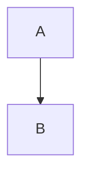

# Fenced block fixture

```bash
git status
```

```sh
git log --oneline
```

```shell
git diff --stat
```

```powershell
Get-ChildItem
```

```pwsh
Get-Location
```

```BASH title="upper case"
git branch
```

```PowerShell
Get-Date
```



```json
{ "name": "fixture" }
```

```
plain text
```

~~~bash
git fetch
~~~

````markdown
```bash
git status
```
````

1. A step in a list:

   ```bash
   git add --all
     git commit
   ```

```bash
git stash list

git remote
```

```text
~~~
```

~~~text
```
~~~

```bash
git tag
````

> ```bash
> git show
> ```

> A question:
>
> ```text
>   [ ] First
>
>   [ ] Second
> ```
>
> After the block.

> > ```bash
>> git describe
 > >git rev-parse HEAD
>

> > git shortlog
> > ```
