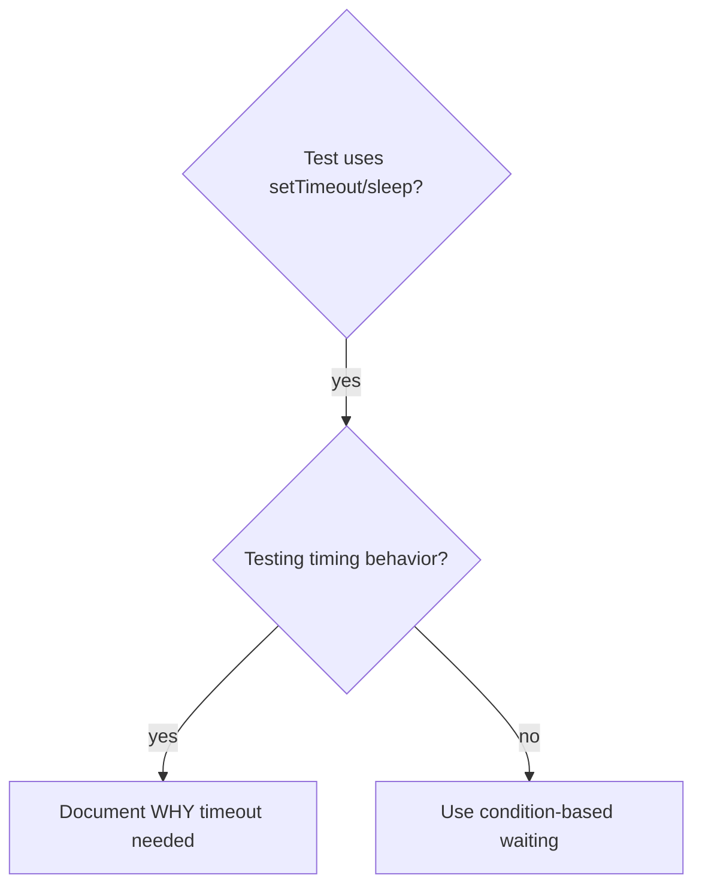

# Condition-based waiting

## Overview

Flaky tests often guess at timing with arbitrary delays. These delays create race conditions where tests pass on fast
machines but fail under load or in CI.

Wait for the actual condition you care about, not a guess about how long it takes.

## Anti-pattern: `sleep 5`

```bash
# Hoping the system is ready after an arbitrary delay
sleep 5
run-next-step
```

Machine speed, CI load, network jitter, and scheduler timing all vary. A fixed sleep only proves that one run happened
to finish inside the guess.

## When to use



Use it when:

- Tests have arbitrary delays (`setTimeout`, `sleep`, `time.sleep()`)
- Tests are flaky (pass sometimes, fail under load)
- Tests time out when run in parallel
- Tests wait for async operations to complete

Do not use it when:

- You test actual timing behavior (debounce, throttle intervals)

If you use an arbitrary timeout, always document WHY.

## Core pattern

```typescript
// BEFORE: Guessing at timing
await new Promise((r) => setTimeout(r, 50));
const result = getResult();
expect(result).toBeDefined();

// AFTER: Waiting for condition
await waitFor(() => getResult() !== undefined, "result to be available");
const result = getResult();
expect(result).toBeDefined();
```

## Quick patterns

Every call passes a condition and a description of what it waits for. The description appears in the timeout error.

| Scenario               | Pattern                                                                               |
| ---------------------- | ------------------------------------------------------------------------------------- |
| Wait for event         | `waitFor(() => events.find((e) => e.type === "DONE"), "DONE event")`                  |
| Wait for state         | `waitFor(() => machine.state === "ready", "machine to be ready")`                     |
| Wait for count         | `waitFor(() => items.length >= 5, "5 items")`                                         |
| Wait for file          | `waitFor(() => fs.existsSync(path), "file to exist")`                                 |
| Wait for open port     | `waitFor(() => canConnect(port), "port to accept connections")`                       |
| Wait for process ready | `waitFor(() => child.exitCode === null && healthcheck(), "process to be ready")`      |
| Complex condition      | `waitFor(() => obj.ready && obj.value > 10, "obj to be ready with a value above 10")` |

The condition can be synchronous or return a promise. `waitFor` awaits it on every attempt, so `canConnect` and
`healthcheck` can be async functions. It stops waiting when the result is truthy. A result of `0`, `""`, `false`,
`null`, or `undefined` means "not yet".

The timeout covers each attempt as well as the gaps between attempts. A promise that has not settled by the deadline
makes `waitFor` reject with the timeout error, and a result that arrives after the deadline is not returned.

## Implementation

Generic polling function with timeout and backoff:

```typescript
async function waitFor<T>(
    condition: () => T | undefined | null | false | Promise<T | undefined | null | false>,
    description: string,
    timeoutMs = 5000,
    initialDelayMs = 10,
    maxDelayMs = 250,
): Promise<T> {
    const deadline = Date.now() + timeoutMs;
    const timeoutError = () => new Error(`Timeout waiting for ${description} after ${timeoutMs}ms`);
    let delayMs = initialDelayMs;

    while (true) {
        // Race each attempt against the deadline, so a promise that never settles cannot outlast the timeout.
        let timer: ReturnType<typeof setTimeout> | undefined;
        const expired = new Promise<never>((_, reject) => {
            timer = setTimeout(() => reject(timeoutError()), Math.max(deadline - Date.now(), 0));
        });
        try {
            const result = await Promise.race([condition(), expired]);
            if (result && Date.now() <= deadline) return result;
        } finally {
            // A timer left running would keep the process alive after waitFor settles.
            clearTimeout(timer);
        }

        const remainingMs = deadline - Date.now();
        if (remainingMs <= 0) throw timeoutError();

        await new Promise((r) => setTimeout(r, Math.min(delayMs, remainingMs)));
        delayMs = Math.min(delayMs * 2, maxDelayMs);
    }
}
```

### Example conditions

```typescript
await waitFor(() => fs.existsSync(outputPath), "output file to exist");
await waitFor(() => canConnect(3000), "port 3000 to accept connections");
await waitFor(() => serverProcess.exitCode === null && healthcheck(), "process ready state");
```

## Common Mistakes

Fast polling, such as `setTimeout(check, 1)`, wastes CPU. Start with a short interval. Back off between retries.

Without a timeout, the loop can run forever. Always include a timeout and a clear error.

If you cache state before the loop, the condition can remain stale. Call the getter inside the loop.

## When an arbitrary timeout is correct

```typescript
// Tool ticks every 100ms - need 2 ticks to verify partial output
await waitFor(() => events.find((e) => e.type === "TOOL_STARTED"), "TOOL_STARTED event"); // First: wait for condition
await new Promise((r) => setTimeout(r, 200)); // Then: wait for timed behavior
// 200ms = 2 ticks at 100ms intervals - documented and justified
```

Requirements:

1. First wait for the triggering condition.
2. Base the timeout on known timing, not on a guess.
3. Add a comment that explains WHY.
