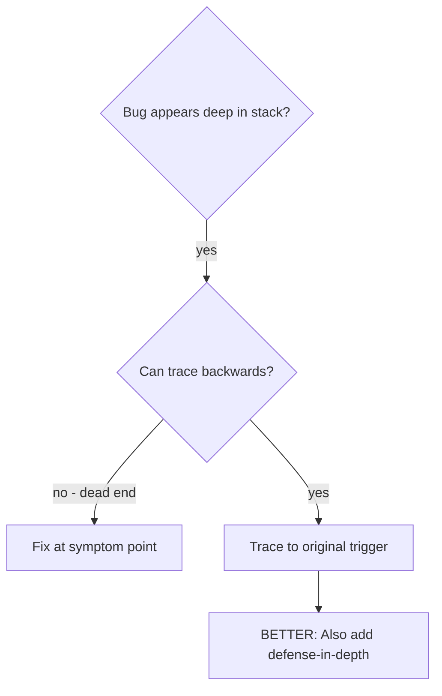
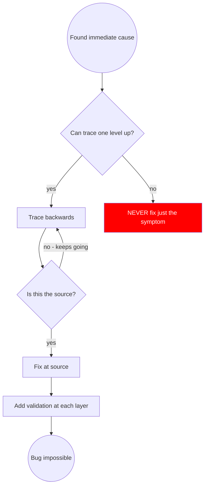

# Root cause tracing

## Overview

Bugs often manifest deep in the call stack (git init in wrong directory, file created in wrong location, database opened
with wrong path). The instinct to fix where the error appears only treats a symptom.

Trace backward through the call chain to the original trigger. Then fix the source.

## When to use



**Use when:**

- Error happens deep in execution (not at entry point)
- Stack trace shows long call chain
- Unclear where invalid data originated
- Need to find which test/code triggers the problem

## Fast isolation tactics

When the culprit is buried in recent changes, narrow the search space first:

- **Binary search commits** - use `git bisect` or manual midpoint testing to isolate the first bad change
- **Binary search config deltas** - disable half the new flags or settings. Then halve again
- **Binary search inputs** - trim failing fixtures or payloads until you find the smallest trigger

Bisection turns "something in the last 20 changes broke this" into a provable culprit.

## The tracing process

### 1. Observe the symptom

```text
Error: git init failed in /home/user/project/packages/core
```

### 2. Find immediate cause

**What code directly causes this?**

```typescript
await execFileAsync("git", ["init"], { cwd: projectDir });
```

### 3. Ask: what called this?

```typescript
WorktreeManager.createSessionWorktree(projectDir, sessionId)
  → called by Session.initializeWorkspace()
  → called by Session.create()
  → called by test at Project.create()
```

### 4. Trace further up

**What value was passed?**

- `projectDir = ''` (empty string!)
- Empty string as `cwd` resolves to `process.cwd()`
- That's the source code directory!

### 5. Find original trigger

**Where did empty string come from?**

```typescript
const context = setupCoreTest(); // Returns { tempDir: '' }
Project.create("name", context.tempDir); // Accessed before beforeEach!
```

### 6. Prove causation

Do not stop at correlation. A suspicious commit, stack frame, or timing coincidence is only a lead until you show the
chain end-to-end.

- Reproduce with the suspected cause present
- Remove or revert only that cause
- Confirm the failure disappears
- Reintroduce it if needed to prove the behavior returns

If you cannot toggle the suspected cause and predict the outcome, you do not yet have the root cause.

## Add stack traces

When you can't trace manually, add instrumentation:

```typescript
// Before the problematic operation
async function gitInit(directory: string) {
    const stack = new Error().stack;
    console.error("DEBUG git init:", {
        directory,
        cwd: process.cwd(),
        nodeEnv: process.env.NODE_ENV,
        stack,
    });

    await execFileAsync("git", ["init"], { cwd: directory });
}
```

**Run and capture:**

```bash
npm test 2>&1 | grep 'DEBUG git init'
```

**Analyze stack traces:**

- Look for test file names
- Find the line number that triggers the call
- Identify the pattern (same test? same parameter?)

## Find which test causes pollution

If something appears during tests but you don't know which test, use the bisection script, which sits next to this file
in the installed Agentics root as `find-polluter.sh` and `find-polluter.ps1`. Run it from the project root, replacing
`<agentics-root>` with the verified install root. Give it the path that appears and a quoted test pattern, so the shell
does not expand the pattern before the script sees it. The path must not exist before the run. On macOS and Linux, run
the `sh` script:

```text
sh "<agentics-root>/skills/diagnose/references/find-polluter.sh" 'packages/core/leaked-state' 'src/**/*.test.ts'
```

On Windows, run the PowerShell script:

```text
powershell -NoProfile -ExecutionPolicy Bypass -File "<agentics-root>\skills\diagnose\references\find-polluter.ps1" 'packages/core/leaked-state' 'src/**/*.test.ts'
```

Read the exit code right after each run: `$?` in Bash, `$LASTEXITCODE` in PowerShell.

The script runs each matching test file on its own, as `npm test <file>`, and stops at the first test after which the
path exists. Set `FIND_POLLUTER_RUNNER` to `pnpm` or `yarn` for a project that uses one of those: in PowerShell, run
`$env:FIND_POLLUTER_RUNNER = 'pnpm'` before the command. The exit code says what the run showed, for both scripts:

| Exit | Meaning                                                                                                    |
| ---- | ---------------------------------------------------------------------------------------------------------- |
| 0    | No polluter found, and every test run exited 0                                                             |
| 1    | A polluter was found                                                                                       |
| 2    | No answer: the path already exists, no test matched, the runner could not start, or you interrupted it     |
| 3    | No polluter found, but some test runs exited non-zero. Those tests may have stopped before they created it |

Treat 2 and 3 as "not yet diagnosed", not as a clean result. See the header of the script for the pattern rules.

Fix the source: make the invalid state unrepresentable. In the trace above, a getter throws if `tempDir` is accessed
before `beforeEach`. Then add layered validation so the bug becomes structurally impossible. See the four-layer example
in [defense-in-depth.md](defense-in-depth.md).

## Document the causal chain

Write the chain explicitly so the fix is auditable:

1. **Trigger** - the original bad input, change, or ordering issue
2. **Propagation** - how that bad state moved through the system
3. **Symptom** - where the failure became visible
4. **Fix point** - the earliest safe place to prevent recurrence

Good debugging notes explain why A caused B caused C. "Changed X and tests passed" is not enough.

## Key principle



## Stack trace tips

In tests, use `console.error()` because the logger may be suppressed. Log before the dangerous operation, not after it
fails. Include the directory, cwd, environment variables, and timestamps. `new Error().stack` shows the complete call
chain.
