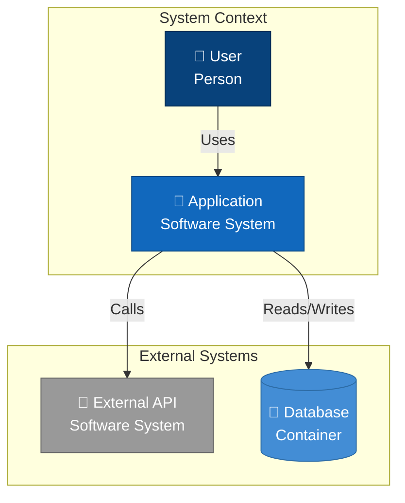
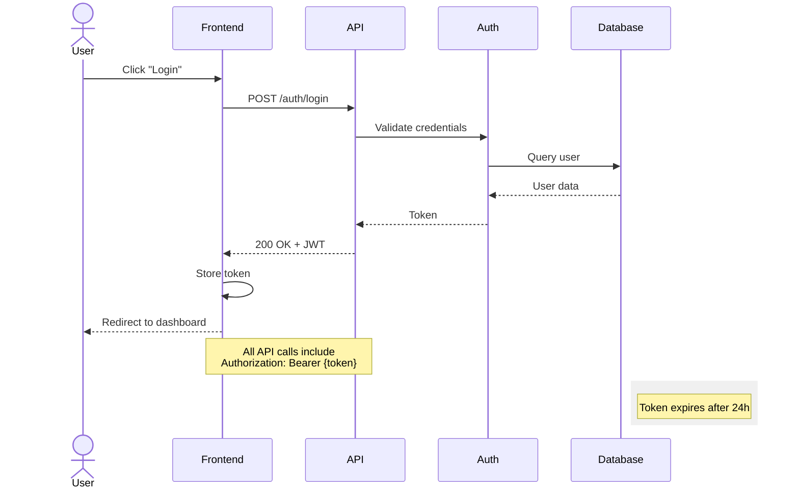
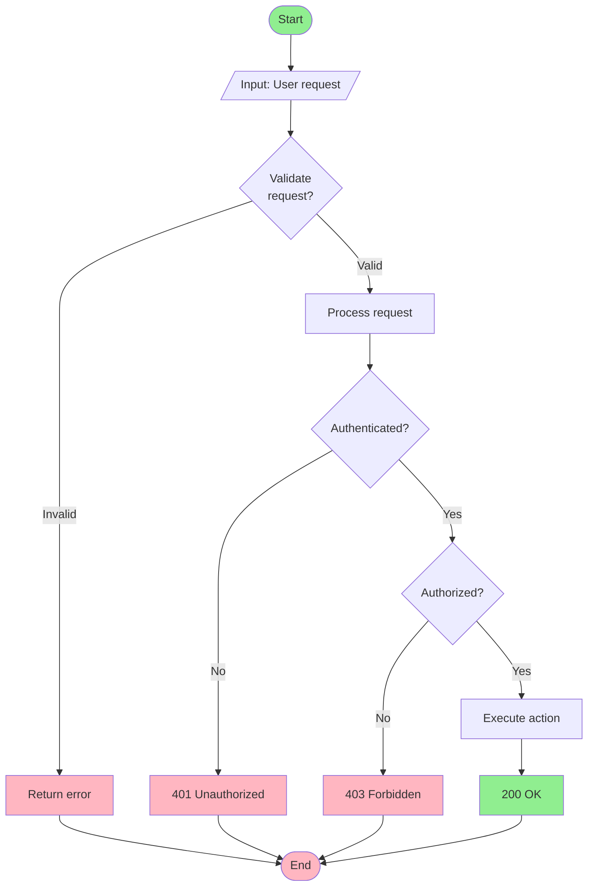
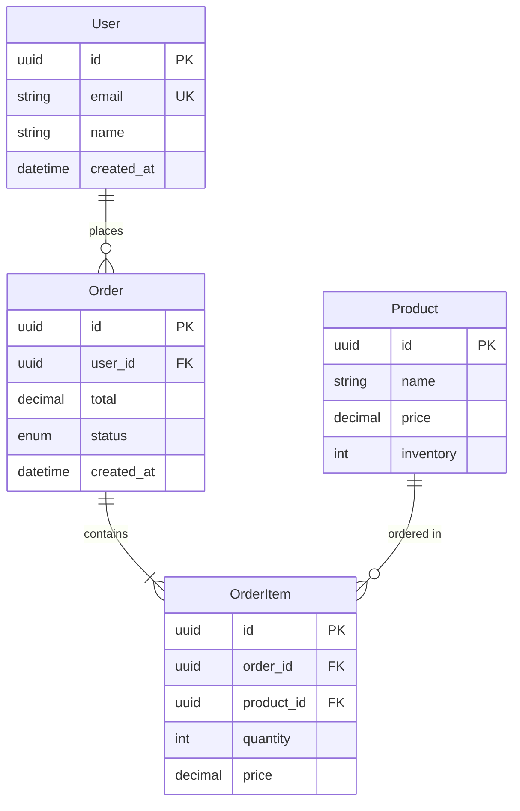
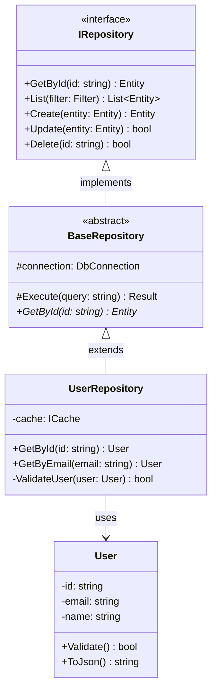
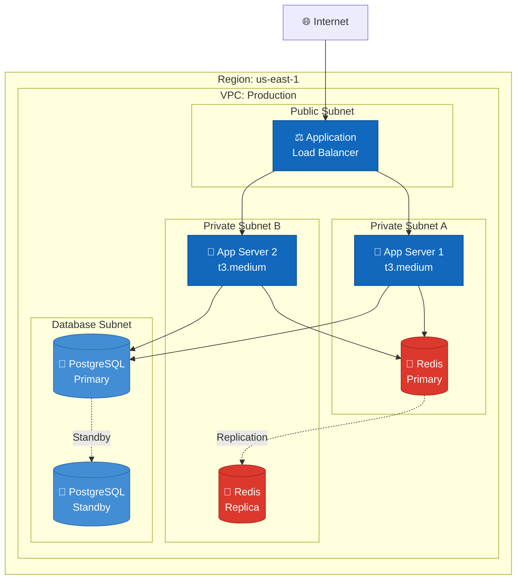

# Mermaid diagram templates: detailed reference

> This file holds Mermaid.js syntax templates, patterns, and examples for all 6 core diagram types.
> [SKILL.md](../SKILL.md) links here.

## Architecture diagram (C4 model)

**Use for**: System context, container views, component diagrams

**Pattern**:



**Template**:

```text
graph TB
    {ComponentID}[{Icon} {Name}<br/>{Type}]

    {ComponentA} -->|{Relationship}| {ComponentB}

    classDef {styleClass} fill:{color},stroke:{borderColor},color:{textColor}
    class {ComponentID} {styleClass}
```

**Component Types**:

- **Person**: 👤 icon, fill:#08427b
- **Software System**: 🏢 icon, fill:#1168bd
- **Container**: 📦 icon, fill:#438dd5
- **External System**: 🔌 icon, fill:#999
- **Database**: 💾 icon (use `[( ... )]` shape), fill:#438dd5

## Sequence diagram

**Use for**: API call flows, authentication flows, distributed system interactions

**Pattern**:



**Template**:

```text
sequenceDiagram
    actor {ActorName}
    participant {ParticipantName}

    {From}->>+{To}: {Message}
    {To}-->>-{From}: {Response}

    Note over {Participant1},{Participant2}: {Note text}

    alt {Condition}
        {Action if true}
    else {AltCondition}
        {Action if false}
    end

    loop {LoopCondition}
        {Repeated actions}
    end

    par {ParallelAction1}
        {Action 1}
    and {ParallelAction2}
        {Action 2}
    end
```

**Arrow Types**:

- `->`: Solid line, no arrowhead
- `-->`: Dashed line, no arrowhead
- `->>`: Solid line with arrowhead (request)
- `-->>`: Dashed line with arrowhead (response)
- `->>+`: Solid line with arrowhead. Activates the receiver's lifeline
- `-->>-`: Dashed line with arrowhead. Deactivates the sender's lifeline

## Flowchart

**Use for**: Decision logic, algorithms, process flows, conditional branching

**Pattern**:



**Template**:

```text
flowchart TD
    {ID}([{Start/End node}])
    {ID}[{Process node}]
    {ID}{"{Decision node}"}
    {ID}[/{Input/Output}/]
    {ID}[(Database)]
    {ID}(({Event}))

    {From} --> {To}
    {From} -->|{Label}| {To}

    style {ID} fill:{color},stroke:{borderColor}
```

**Node Shapes**:

- `([...])`: Rounded rectangle (start/end)
- `[...]`: Rectangle (process)
- `{...}`: Diamond (decision)
- `[/..../]`: Parallelogram (input/output)
- `[(....)]`: Cylinder (database)
- `((....))`: Circle (event)

**Flow Directions**:

- `flowchart TD`: Top to bottom
- `flowchart LR`: Left to right
- `flowchart BT`: Bottom to top
- `flowchart RL`: Right to left

## Entity-relationship diagram

**Use for**: Database schemas, data models, table relationships

**Pattern**:



**Template**:

```text
erDiagram
    {Entity1} {Relationship} {Entity2} : {Label}

    {Entity} {
        {type} {column_name} {constraints}
    }
```

**Relationship Types**:

- `||--||`: One to one
- `||--o{`: One to zero or more
- `}o--o{`: Zero or more to zero or more
- `||--|{`: One to one or more
- `}o--||`: Zero or more to one

**Constraint Notations**:

- `PK`: Primary Key
- `FK`: Foreign Key
- `UK`: Unique Key

Mermaid supports only these three keys. Put other constraints, such as Not Null, in an attribute comment. An example is
`string email UK "NOT NULL"`.

## Class diagram

**Use for**: OOP class structures, inheritance hierarchies, interfaces

**Pattern**:



**Template**:

```text
classDiagram
    class {ClassName} {
        <<{stereotype}>>
        {visibility}{member}: {type}
        {visibility}{method}({params}) {returnType}
    }

    {Class1} <|-- {Class2} : extends
    {Class1} <|.. {Class2} : implements
    {Class1} --> {Class2} : uses
    {Class1} --* {Class2} : composition
    {Class1} --o {Class2} : aggregation
```

**Visibility Modifiers**:

- `+`: public
- `-`: private
- `#`: protected
- `~`: package/internal

**Stereotypes**:

- `<<interface>>`
- `<<abstract>>`
- `<<enum>>`
- `<<service>>`

**Relationship Types**:

- `<|--`: Inheritance (extends)
- `<|..`: Realization (implements)
- `-->`: Association (uses)
- `--*`: Composition (owns)
- `--o`: Aggregation (has)

## Deployment diagram

**Use for**: Infrastructure topology, server architecture, deployment environments

**Pattern** (a flowchart with custom styling):


