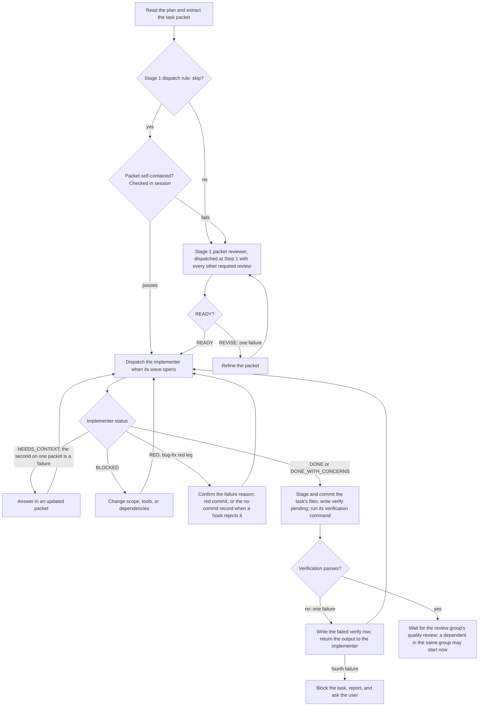
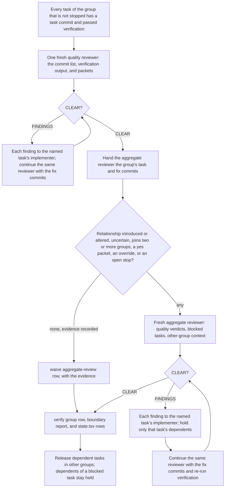

# Review-gated process: visual flow

These diagrams draw the rules of `SKILL.md` Step 2. When a diagram and the text differ, the text wins.

## Per task

Stage 1 is front-loaded: Step 1 sub-step 8 dispatches every required packet reviewer for every wave, in batches within
the surface's limit. The wait at the top of this diagram is for that task's own verdict, not a fresh round trip at the
start of its wave. Every failure in this diagram counts once on the task's one failure ladder
([two-strike-stop.md](two-strike-stop.md)): two failures bring one fresh implementer, and four stop the task.

## Per review group

A review group is a slice of a sliced plan, a wave of an unsliced plan, or the tasks that share a `**Review group:**`
name. Its quality review starts once every task of the group that is not stopped has a task commit that passed the
controller's verification. A stopped task does not hold the group; the review covers the tasks that committed and names
the stopped task, whose dependents stay held.

The reviewer receives the list of the group's commits, each labelled with its task, never a range and never the live
tree. Findings name a task. Each goes to that task's implementer, and the same reviewer is continued with the fix
commits. A fix that does not close its finding counts once on the ladder of the task the finding names. The reviewer's
verdict writes each task commit's final `verify` row.

After the quality review clears, the controller hands the aggregate reviewer the group's task and fix commits, and
decides the integration review under [aggregate-wave-review.md](aggregate-wave-review.md). A group never skips while a
stop is open in it, or while the plan's proportionality line reads `override by user`.

At each wave's end the controller runs the wave's integration verification, plus the Outcome proof on the skeleton wave,
and records `verify wave-<N>`. It then computes the wave's divergence before it releases any later task. A packet the
wave's diff touched goes back through Stage 1, within its re-review budget.

