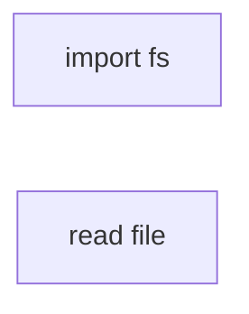

# Writing skills: advanced patterns and testing

> This file holds the testing method, bulletproofing techniques, anti-patterns, and the full creation checklist, moved
> out of the core `SKILL.md`.

## Test before you revise

For new skills and edits, observe a failing application case before you draft the correction. That case connects the
change to behavior that needs improvement. The 'tdd' skill explains the testing method.

Test-first is the default order. Choosing another order is a process gate. If the user asks for another order, do these
steps:

1. Explain the evidence cost once.
2. When the next reply still declines test-first, follow the user's order.
3. Record the yield.
4. Preserve existing work.

Never claim a baseline or successful evaluation that did not run.

## Testing all skill types

### Discipline-enforcing skills (rules/requirements)

**Examples:** TDD, gate, planning

**Test with:**

- Academic questions: Do they understand the rules?
- Pressure scenarios: Do they comply under stress?
- Multiple pressures combined: time + sunk cost + exhaustion
- Distinguish safety-boundary failures from authorized process overrides
- Add explicit counters only for measured safety failures

**Success criteria:** The agent holds safety boundaries under pressure and yields process gates under user authority

### Technique skills (how-to guides)

**Examples:** condition-based-waiting, root-cause-tracing, defensive-programming

**Test with:**

- Application scenarios: Can they apply the technique correctly?
- Variation scenarios: Do they handle edge cases?
- Missing information tests: Do instructions have gaps?

**Success criteria:** The agent applies the technique to a new scenario

### Pattern skills (mental models)

**Examples:** reducing-complexity, information-hiding concepts

**Test with:**

- Recognition scenarios: Do they recognize when the pattern applies?
- Application scenarios: Can they use the mental model?
- Counter-examples: Do they know when NOT to apply?

**Success criteria:** The agent correctly identifies when and how to apply the pattern

### Reference skills (documentation/APIs)

**Examples:** API documentation, command references, library guides

**Test with:**

- Retrieval scenarios: Can they find the right information?
- Application scenarios: Can they use what they found correctly?
- Gap testing: Are common use cases covered?

**Success criteria:** The agent finds and correctly applies reference information

## Why application testing matters

Clear wording and academic review do not show that an agent can apply a skill. Test retrieval for references and
realistic application for workflows. When testing is deferred, report the evidence gap, not confidence as a passing
result.

## Bulletproofing skills against rationalization

Apply the
[reason-versus-loophole rule](../forging/forging-skills.md#3-make-the-wording-persuasive-enough-to-hold-under-pressure)
before you use the techniques below. By default, explain the reason. Use loophole tables or red-flag lists only for a
safety gate that a measured adversarial run broke. Process gates remain yieldable. The examples below do not make every
authoring step an absolute gate.

For a safety gate that failed under pressure, identify the exact workaround the run attempted before you choose a
counter.

**Psychology note:** [governance-details.md](../governance/governance-details.md#persuasion-principles-for-skill-design)
gives the research foundation (Meincke et al., 2025) for why the authority, commitment, scarcity, social proof, and
unity principles work.

### Close the demonstrated loophole explicitly

Use the measured failure to make the boundary precise. For example, if a run falsely claimed success without scorecards:

**Bad example:**

```text
Report evaluation results accurately.
```

In these examples, a "passing stamp" is the evaluation record a repository keeps for the asset. Where the repository
keeps no record, it is the report's `passing` recommendation. Forge writes neither without this run's scorecards.

**Good example:**

```text
Claim passing only from this run's qualifying scorecards.
If no scenarios ran, say "not evaluated" in the report and leave the passing stamp unset.
An optimistic summary cannot substitute for missing evidence.
```

### Address "spirit vs letter" arguments

Explain the harm behind the boundary. An unsupported passing stamp causes later users to trust untested behavior. This
reason supports the evidence requirement. The order of internal workflow steps stays a process matter that the user may
change.

### Build a rationalization table

If repeated rationalizations caused the measured safety failure, capture only those in a targeted table:

```markdown
| Excuse                               | Reality                                               |
| ------------------------------------ | ----------------------------------------------------- |
| "The wording looks better"           | Wording review cannot establish a passing evaluation. |
| "The user asked for a passing stamp" | The stamp reports measured evidence.                  |
```

### Create a red-flags list

Use a red-flag list only when it helps catch the measured safety failure:

```markdown
## Check Before Claiming Passing

- No scorecards from this run
- Scores below the required bar
- Content changed since the evaluated digest

Resolve the missing evidence before claiming passing. Preserve the work and report its actual status.
```

### Update CSO for violation symptoms

Add to the description the symptoms of when you're ABOUT to violate the rule:

```yaml
description: use when evaluating an asset and reporting its measured quality
```

## RED-GREEN-REFACTOR for skills

By default, follow the TDD cycle. A user override follows [Test before you revise](#test-before-you-revise).

### RED: write a failing test (baseline)

Run a pressure scenario with a subagent WITHOUT the skill. Document the exact behavior:

- What choices did they make?
- What rationalizations did they use (verbatim)?
- Which pressures triggered violations?

This is "watch the test fail": see what agents naturally do before you write the skill.

### GREEN: write a minimal skill

Address those specific rationalizations. Add nothing for hypothetical cases.

Run the same scenarios WITH the skill. The agent should now comply.

### REFACTOR: close loopholes

When a measured adversarial run breaks a safety gate, add a counter for that demonstrated failure. Re-test after you add
the counter. For process gates, improve the explanation or remove a misleading instruction.

[../evals/testing-skills-with-subagents.md](../evals/testing-skills-with-subagents.md) has the complete testing method:

- How to write pressure scenarios
- Pressure types (time, sunk cost, authority, exhaustion)
- How to plug holes systematically
- Meta-testing techniques

For concrete test case examples, see [../examples/claude-md-testing.md](../examples/claude-md-testing.md).

## Anti-patterns

### Narrative example

"In session 2025-10-03, we found empty projectDir caused..." **Why bad:** Too specific, not reusable

### Multi-language dilution

example-js.js, example-py.py, example-go.go **Why bad:** Mediocre quality, maintenance burden

### Code in flowcharts



**Why bad:** Can't copy-paste, hard to read

### Generic labels

helper1, helper2, step3, pattern4 **Why bad:** Labels should have semantic meaning

### All skills loaded upfront

Every skill loaded into context at session start. **Why bad:** It removes the context benefit of progressive disclosure.
Register only skill metadata. Load the skill body on a trigger match.

### A skill where a sub-agent is warranted

Isolation-sensitive logic crammed into a skill instead of an agent. **Why bad:** Skills don't enforce tool boundaries.
If the specialization needs its own tool allowlist or content filter policy, use multi-agent orchestration instead.

### Session or user context left for the model to derive

An expectation that the model infers user type, environment, or session attributes from injected context. **Why bad:**
It is non-deterministic; the model may misread or ignore it. Resolve user type and session attributes in code before the
skill executes. Pass them as resolved facts.

## Before you move to the next skill

Verify each skill before you move on, so failures remain attributable to one change. If the user authorizes batching or
defers verification, do these steps:

1. Record that process override.
2. Retain each skill's evidence gap.

Do not imply that an untested skill passed. Do not treat permission to continue locally as permission to publish.

## Skill creation checklist (TDD adapted)

Track each checklist item below under [workflow steps](../../../routing/references/contracts/workflow-steps.md).

**RED phase. Write a failing test.**

- [ ] Create pressure scenarios for discipline skills, each combining the number of pressures that
      [Pressure types](../governance/governance-details.md#pressure-types) recommends per scenario
- [ ] Run scenarios WITHOUT the skill. Document the baseline behavior verbatim.
- [ ] Identify patterns in rationalizations/failures

**GREEN phase. Write a minimal skill.**

- [ ] The name is lowercase kebab-case, at most 64 characters, and equal to the directory name, as the
      [structural rules](../forging/forging-skills.md#skillmd-structural-rules) state
- [ ] The YAML frontmatter follows the frontmatter contract in the
      [structural rules](../forging/forging-skills.md#skillmd-structural-rules)
- [ ] The description starts with "Use when..." and includes specific triggers/symptoms
- [ ] The description is in third person (a "Use when..." trigger counts)
- [ ] Keywords throughout for search (errors, symptoms, tools)
- [ ] A clear overview with the core principle
- [ ] Address the specific baseline failures identified in RED
- [ ] Code inline OR a link to a separate file
- [ ] One excellent example (not multi-language)
- [ ] Run scenarios WITH the skill. Verify that agents now comply.

**REFACTOR phase. Close loopholes.**

- [ ] Identify NEW rationalizations from testing
- [ ] State each gate once with its class: safety gate, repository policy, or process gate, as the
      [three gate classes](skill-hardening-checklist.md#b-pressure-resilience--hold-the-boundary-under-adversarial-input)
      define them
- [ ] For a measured safety-gate failure, add a targeted counter. Then re-test the failed scenario.
- [ ] Use a rationalization table or red-flag list only when that measured safety failure warrants one
- [ ] Let each process gate name its cost once and, when the next reply still declines, yield. Improve its rationale, or
      remove misleading instructions.

**Quality checks:**

- [ ] A small flowchart only if the decision is non-obvious
- [ ] No narrative storytelling
- [ ] Supporting files only for tools or heavy reference

**Deployment:**

- [ ] Commit the skill to git. Push it to your fork (if configured).
- [ ] If the skill is broadly useful, consider a PR to contribute it back
