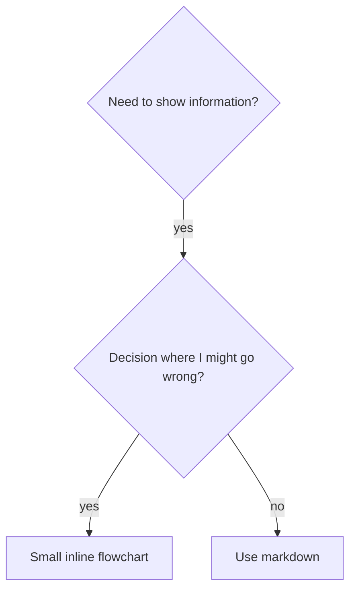

# Copilot Search Optimization (CSO) guide

How to make skills discoverable by Copilot.

## Keyword coverage

Use words Copilot would search for:

- Error messages: "Hook timed out", "ENOTEMPTY", "race condition"
- Symptoms: "flaky", "hanging", "zombie", "pollution"
- Synonyms: "timeout/hang/freeze", "cleanup/teardown/afterEach"
- Tools: Actual commands, library names, file types

## Token efficiency (critical)

**Problem:** Skills that load frequently consume context in EVERY conversation, so every line of a SKILL.md entry point
costs context each time it loads.

**The one size limit:** each `SKILL.md`, and every other file under `skills/`, is at most 40,000 bytes, checked by
`skill-file-size`, as the [SKILL.md structural rules](../forging/forging-skills.md#skillmd-structural-rules) state. The
limit is in bytes because a host reads a file in one tool call, and Codex estimates a tool output's tokens as
`ceil(bytes / 4)` and keeps only 10,000 tokens of one output, so a file over 40,000 bytes loses its middle. There is no
word budget. Within that limit, write as concisely as the skill allows, and push detailed content (reference tables,
deep dives, templates, examples) into `references/`. Total skill content (entry point + references) is unlimited, as
long as each file stays within the limit.

**Techniques:**

**Move details to tool help:**

```bash
# ❌ BAD: Document all flags in SKILL.md
search-conversations supports --text, --both, --after DATE, --before DATE, --limit N

# ✅ GOOD: Reference --help
search-conversations supports multiple modes and filters. Run --help for details.
```

**Use cross-references:**

```markdown
# ❌ BAD: Repeat workflow details

When searching, dispatch subagent with template... [20 lines of repeated instructions]

# ✅ GOOD: Reference other skill

Always use subagents (50-100x context savings). REQUIRED: Use [other-skill-name] for workflow.
```

**Compress examples:**

```markdown
# ❌ BAD: Verbose example (42 words)

your human partner: "How did we handle authentication errors in React Router before?" You: I'll search past
conversations for React Router authentication patterns. [Dispatch subagent with search query: "React Router
authentication error handling 401"]

# ✅ GOOD: Minimal example (20 words)

Partner: "How did we handle auth errors in React Router?" You: Searching... [Dispatch subagent → synthesis]
```

**Eliminate redundancy:**

- Don't repeat what's in cross-referenced skills
- Don't explain what's obvious from the command
- Don't include multiple examples of the same pattern

## Descriptive naming

The name is lowercase kebab-case, at most 64 characters, and equal to the skill's directory name, checked by
`skill-name-format`, as the [SKILL.md structural rules](../forging/forging-skills.md#skillmd-structural-rules) state.

**Name by the core insight or the job, in the words people search for:**

- `recall` not `context-reconstruction`
- `flatten-with-flags` > `data-structure-refactoring`
- `root-cause-tracing` > `debugging-techniques`

## Cross-references to other skills

When a document points the agent at another skill, use the skill name, with explicit requirement markers:

```text
- ✅ Good: `**REQUIRED SUB-SKILL:** Use the 'tdd' skill`
- ✅ Good: `**REQUIRED BACKGROUND:** You MUST understand the 'debugging' skill`
- ❌ Bad: `See skills/testing/tdd` (unclear if required)
- ❌ Bad: `@skills/testing/tdd.md` (force-loads, burns context)
```

When a document references a file of another skill, use a relative Markdown link to that file, for example
`[language.md](../../deepen/references/language.md)` from a file in a skill's `references/`. The link rules check that
every such link resolves.

**Why no @ links:** `@` syntax force-loads files immediately and consumes 200k+ context before you need them.

## Flowchart usage



**Use flowcharts ONLY for:**

- Non-obvious decision points
- Process loops where you might stop too early
- "When to use A vs B" decisions

**Never use flowcharts for:**

- Reference material → Tables, lists
- Code examples → Markdown blocks
- Linear instructions → Numbered lists
- Labels without semantic meaning (step1, helper2)

## Code examples

### One excellent example beats many mediocre ones

Choose the most relevant language:

- Testing techniques → TypeScript/JavaScript
- System debugging → Shell/Python
- Data processing → Python

**Good example:**

- Complete and runnable
- Well-commented, and the comments explain WHY
- From a real scenario
- Shows the pattern clearly
- Ready to adapt (not a generic template)

**Don't:**

- Implement in 5+ languages
- Create fill-in-the-blank templates
- Write contrived examples

You port code well, so one great example is enough.

## File organization

### Self-contained skill

```text
defense-in-depth/
  SKILL.md    # Everything inline
```

When: All content fits, and no heavy reference is needed

### Skill with reusable tool

```text
condition-based-waiting/
  SKILL.md    # Overview + patterns
  example.ts  # Working helpers to adapt
```

When: The tool is reusable code, not just narrative

### Skill with heavy reference

```text
pptx/
  SKILL.md         # Overview + workflows
  references/
    pptxgenjs.md   # 600 lines API reference
    ooxml.md       # 500 lines XML structure
  scripts/         # Executable tools
```

When: The reference material is too large for inline. Reference files live in `references/`.
