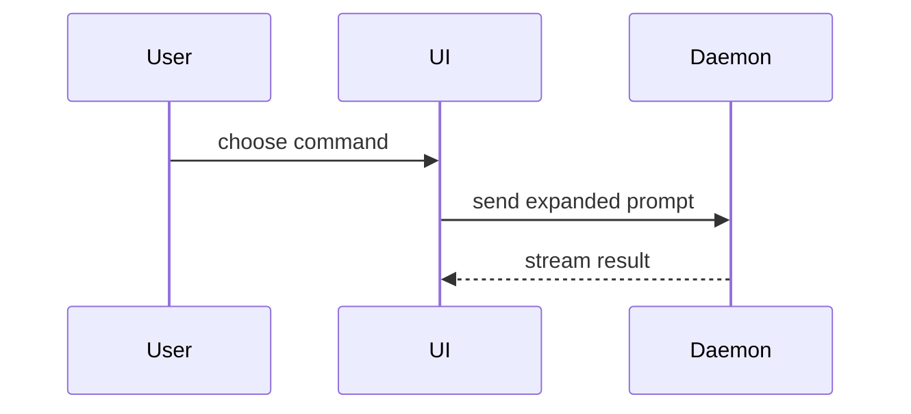
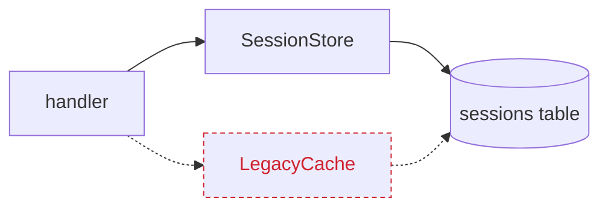

# PR body contract

The shape of every pull request description Agentics writes or edits: on create, on stack layers, and on refresh.
[SKILL.md](../../SKILL.md#pull-request-creation-workflow) says when it applies; this file says what goes in the body.

A reviewer opens the body to learn four things: what changed, why, how it was verified, and what could break. Answer
them in three blocks, **Summary**, **Evidence**, and **Impact**. Make each block as short as possible and keep its
granularity. Skip the preamble. Do not narrate a diff the reviewer already has open. There is no word target. Cut every
sentence that does not change what the reviewer knows. Keep every sentence that does.

A pull request title and body carry no AI attribution. The body paraphrases the user's instruction and never quotes the
user's chat words. The [outbound checks](../posting-envelope.md#outbound-checks) of the posting envelope apply to a pull
request body as they apply to a comment.

## Summary

One or two sentences on what changed and why, then the smallest visual that makes the key point clear. Use the
repository's own vocabulary from the glossary [repo-conventions.md](../../../routing/references/repo-conventions.md)
resolves. Never give a settled concept a new name.

When the user explicitly decided to depart from a repository rule, put the `Divergence:` line from
[user-authorized-divergence.md](../../../routing/references/user-authorized-divergence.md) in this block. It is a
statement in the description. It is not a publication step.

Pick the view by what the change is. Start with the first answer that fits:

1. **Parts interact.** Two or more parts now call, read, hand off to, or wait on each other, or the change alters that.
   Draw Mermaid. Mermaid covers control flow, data flow, a sequence between components, a state machine, a pipeline, a
   dependency graph, and a stack of layers. A list of arrows in a `text` block renders as plain text and does not show
   the shape. Do not use one in its place.
2. **One unit or a layout.** The change is inside one unit, or it is a layout. Use pseudocode, a call tree, a component
   tree, or a file tree.
3. **A change in an existing shape.** The point is only what changed in a shape that already exists. Use `diff`.

The reviewer reads the body on GitHub, which renders Mermaid. Do not fall back to a tree because your own terminal shows
raw text. Use a tree for a flow only when the body goes to a host that does not render Mermaid.

- Show component interaction, control flow, data flow, or state with Mermaid. Use a type that GitHub renders:
  `flowchart`, `sequenceDiagram`, `stateDiagram-v2`, `classDiagram`, or `erDiagram`. Keep the diagram to about eight
  nodes. Name each node with the repository's own vocabulary. Wrap a label that holds parentheses, colons, or slashes in
  double quotes. A syntax error renders as an error box in the body. Read the diagram once before you publish it.



- When the change reworks an existing flow, show it in one diagram. Mark what is new and what is removed, so the
  reviewer sees the delta without comparing two pictures:



- Show logic or an algorithm as pseudocode:

```text
on(save)
  if content is unchanged
    return cached result
  write new content
  return fresh result
```

- Show runtime control flow as a call tree:

```text
submitForm
  createSession
    persistPrompt
    launchAgent
  navigateToSession
```

- Show UI structure as a component tree, with the state and module boundaries that matter:

```text
<SessionPage> (apps/example/src/routes/session.tsx)
  useSessionEvents()
  <SessionToolbar>
    <RunSkillButton> (packages/ui)
```

- Show file responsibility or a broad refactor as a shallow file tree:

```text
src/
├── commands/       # parses user actions
├── sessions/       # owns session state
└── transport/      # sends API requests
```

- Use `diff` when the point is what changes and the surrounding shape already exists. Match the diff's shape to the
  topic: a component tree, a file layout, a call tree, or a state change.

```diff
 src/
 ├── commands/
+│   └── show-me.ts       # expands the slash command
 ├── sessions/
-└── transport.ts
+└── transport/
+    ├── client.ts
+    └── stream.ts
```

```diff
 on(save)
-  write content
+  if content is unchanged
+    return cached result
+  write new content
+  invalidate cache
```

- Show the whole block in any of these cases:
    - Most of it is new.
    - Omitted context would hide ownership or order.
    - The reviewer needs the target shape.

Place each visual next to the sentence it supports. Keep only the calls, files, props, states, and boundaries the
reviewer needs. One visual is the usual case, and several are rare. Zero is correct only when the change has no shape to
show. That means one of these cases: a prose fix, a version bump, a one-line default, or a mechanical rewrite of wording
across files. A change that adds, removes, or reroutes a call, a handoff, a state, or a layer has a shape. Give that
change a visual. Never add a visual so the section looks complete.

## Evidence

Show that the change works with a before and an after. Take both from work actually performed: in this session, or in a
run you can link. Use the first kind that applies, strongest first:

- **Visual change.** Before and after screenshots, when the environment can capture them. Attach them as
  [../images.md](../images.md) describes. When it cannot, say so. Then use the next kind.
- **Behavior change.** The exact test, command, or output that failed or differed before and passes or differs now. Name
  the command. Show the lines that changed, not the whole log.
- **No meaningful before.** A new file, a docs change, or a refactor with unchanged behavior. Say so. State what you
  verified and where verification stops, for example: "Behavior unchanged; `go test ./internal/evals/...` passes before
  and after; no integration run."

Never invent a pre-change failure, a screenshot, a CI result, or a rollback you did not perform. "Tests pass" alone is a
claim, not evidence. Name a check you could not run as not run, with the reason.

Gate's audit status lines never enter the body. They are `Review:`, `Docs:`, `Security:`, `Controller audit:`,
`Red commit: none recorded | checked (...)`, `Converge:`, `Agent instructions:`, `Work folder:`, `Reconcile:`, and
`Flow metrics:`. They are dense check data that gate keeps in its chat report and its `state.tsv` record. On a squash
merge the body becomes the commit message, where a tally line tells a future reader nothing. A check that passed needs
no sentence. Passing tests already appear as the before and after.

The same holds for every other workflow's status lines, signal lists, and machine-only fields: none of them enters the
body. The one exception is the small-fix hand-off fields below.

A small fix's hand-off fields are not status lines. When gate passes `Small fix:`, `Why:`, `Signals:`, and
`Red commit: <sha> | n/a: not a bug fix | n/a: test declined; <check> failed before the change | n/a: test declined; covered by <test>`,
keep them in the body as given. Gate's red-commit check reads that SHA from the body, so omitting it raises a false
missing-red-commit finding.

Say in plain sentences only what a reviewer must weigh. Use the reviewer's vocabulary, not the status line's:

- A check that failed or did not run, with the reason and who accepted the risk. For example: "The test suite did not
  run here because there is no Go toolchain. CI runs it on push, and merge waits for that check."
- A finding the user accepted or deferred, in one sentence with the reason or the issue link.

When gate supplies none of these, add nothing after the before and after.

## Impact

State what merging could cost, concretely, in two parts.

- **Reversibility.** What reverting the merge undoes and what it does not. A code revert does not unsend messages or
  un-run a migration. It does not rewrite data already stored in a new format, or unpublish a release, a package, or a
  page. Name each such effect and how it would be undone, or say that it cannot be.
- **Blast radius.** What could break, and for whom. Examples: consumers of a changed interface, a config default, a
  layout, a CI job, a hook every session runs. Name them. Say where the reviewer should read hardest.

Breaking changes and the migration a consumer must take belong here. Never write a one-word verdict ("low", "safe",
"two-way door") or a blanket assurance. When the user asks for one, say once what is held (the verdict), the harm (a
reviewer trusts a judgment nobody showed) and the alternative (the concrete reason the change is small), then write the
alternative. When the honest answer is small, say what makes it small: "Docs only; reverting removes the paragraph."

## Placing the blocks

### Under a repository template

The template's headings and their exact order win. Fill them in place. Never add, rename, or reorder any heading (for
example, if `Breaking changes` appears before `Verification`, keep `Breaking changes` before `Verification`).

| Block    | Goes in the first section of this kind                      |
| -------- | ----------------------------------------------------------- |
| Summary  | description: What changed, Description, Summary, Changes    |
| Evidence | verification: Verification, Testing, How to test, Test plan |
| Impact   | risk: Breaking changes, Risk, Rollout, Impact               |

A block with no matching section becomes a labelled paragraph, `**Evidence:**` or `**Impact:**`, at the end of the
Summary's section. Fill every other section and line the template requires, such as issue linkage or a checklist, the
way it asks, keeping every template checklist item intact (never collapse a checklist into a single summary line) and
searching the diff and repository for callers, scripts, jobs, or consumers to name concretely in Impact. Never write
unresolved bracketed placeholders (`<trunk>`, `<summary>`, `<test command>`) into a created or edited body—derive
concrete facts from the diff and repo (and state explicitly if a check did not run rather than inventing a pass claim or
stopping a named create unnecessarily). The linkage line (`Closes #N`, or a plain `Part of #N`) with no linkage section
goes at the end of the Summary's section.

A template with no description section takes Summary in its first section, and the unmatched blocks follow it there. A
template with no headings at all takes every block, `**Summary:**` included, as a labelled paragraph at the top, ahead
of its own text. Neither case adds a heading.

For Agentics's own template: Summary under `## What changed`, Evidence under `## Verification`, Impact under
`## Breaking changes`, and linkage under `## Issue linkage`.

### With no template

```markdown
## Summary

## Evidence

## Impact
```

The linkage line (`Closes #N`, or a plain `Part of #N`) goes on its own line at the end of `## Summary`. An unlinked PR
adds no linkage line.

## Native stack layers

**Confirm the stack on GitHub before you write a single layer body.**

PRs whose bases point at each other are not a stack. An agent that skips the link leaves a chain that GitHub shows as
unrelated PRs.

1. A new stack exists after `gh stack submit --auto`. Existing PRs become a stack only after
   `gh stack link <bottom> … <top>`, with `--base <trunk>` when trunk is not the default branch. A base retarget alone
   creates nothing.
2. Run the GraphQL check in
   [Definition of done: GitHub confirms the stack](../../SKILL.md#definition-of-done-github-confirms-the-stack). A null
   `stack`, or a `totalCount` or PR list that differs from the intended chain, sends you back to step 1.
3. Only then write each layer's body to a scratch file, bottom to top. In the edit call, load the file location from the
   file-write result or its scratch record into `$body_file`. Use the verified PR number as `$pr_number` and run
   `gh pr edit "$pr_number" --body-file "$body_file"`. The user's request for the stack, or the one confirmation the
   stack offer got, covers these edits.

Each layer's body describes only that layer's diff against the layer below it. Its Summary opens with one position line
(`Layer 2 of 3 — builds on #41.`). The bottom layer names its trunk branch instead of a PR
(`Layer 1 of 3 — builds on <trunk>.`). Each layer's Impact states what the layer breaks if it merges while the layers
above it do not.

## Refresh

A body describes the final diff, not the first draft. When new commits or a review decision change what an open PR does,
rewrite the affected blocks. Take the content from the current diff against the PR's base. Do not append "Update:" notes
or a revision log. On a squash merge the body becomes the commit record, where a revision log is noise. An edit to a
published body is a write. When the user named the edit ("update the PR"), verify the target and edit the body with no
wait, then show the body you wrote. When nobody named it, draft the new body, show it, and confirm once before you edit.
