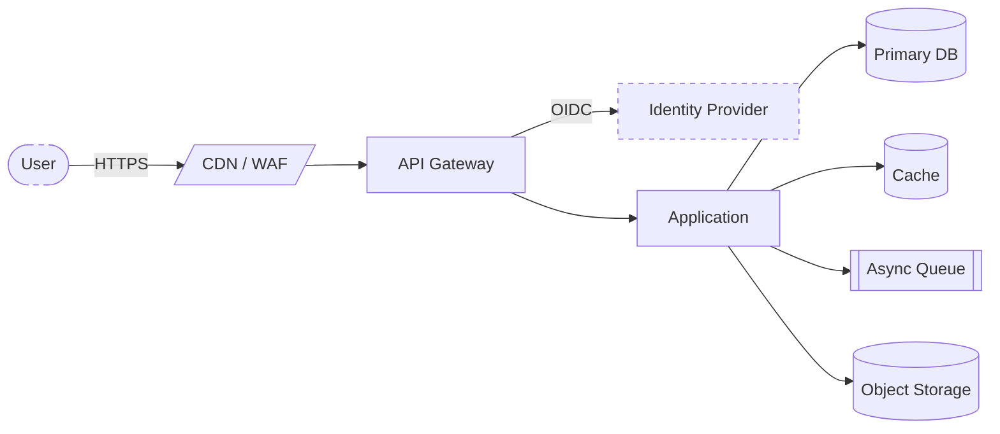

# Threat model template

Render the output of [threat-model-workflow.md](threat-model-workflow.md) with this template. Replace the `{}`
placeholders. Remove each section that genuinely does not apply. Leave a one-line note that explains why.

---

# Threat Model — {System Name}

| Field            | Value                                |
| ---------------- | ------------------------------------ |
| System           | {Service / feature / component}      |
| Version / commit | {git SHA or release}                 |
| Date             | {YYYY-MM-DD}                         |
| Author           | {Name / role}                        |
| Reviewers        | {Security, Architect, Product, ...}  |
| Classification   | {Public / Confidential / Restricted} |
| Status           | {Draft / Reviewed / Approved}        |
| Next review      | {YYYY-MM-DD or trigger event}        |

`Status` describes this document, not the system. The skill writes `Draft`. `Reviewed` and `Approved` are set when the
user says so, and `Approved` only when both of these hold:

- Every Critical and High threat has a named owner, not `unassigned`.
- Every accepted risk in section 8 cites a `Source` other than `Unverified — no artifact cited`.

When either fails, the status stays where it was and the report names what is missing. No value of this field ever says
the system is secure, because this model read no code.

## 1. Scope

{One paragraph describing what is in scope, what is out, the deployment surface, data classification, and compliance
scope. End it with: "This model covers the design as described. It read no code, so it does not say whether the
implementation matches the design or whether any mitigation below was built."}

**In scope.** {bullet list}

**Out of scope.** {Bullet list. Name what readers might assume is in scope but is not, with a reason. Name every
candidate document the search found and did not use.}

**Compliance scope.** {SOC2 / PCI / HIPAA / GDPR / FedRAMP. Include only the ones that change controls.}

## 2. Architecture

{Brief description of the system, the request lifecycle, and where data lives.}



**Trust boundaries.** {Bullet list. Name each crossing edge, the protocol, and the authentication that protects it.}

## 3. Assets

| Asset     | Classification | Owner  | Storage               | Why it matters      |
| --------- | -------------- | ------ | --------------------- | ------------------- |
| {asset 1} | Confidential   | {team} | {DB / cache / object} | {single-line stake} |
| {asset 2} | Internal       | {team} | {storage}             | {stake}             |

## 4. Actors

| Actor     | Trust level | Channel      | Motivation                      |
| --------- | ----------- | ------------ | ------------------------------- |
| {actor 1} | Untrusted   | {public web} | {takeover, exfil, abuse}        |
| {actor 2} | Limited     | {auth API}   | {legitimate use; opportunistic} |
| {actor 3} | Insider     | {internal}   | {data exfil, sabotage}          |

## 5. STRIDE Findings

One row per identified threat, sorted by rating. In a short model, threats rated Medium and Low may instead take one
line each in a list below the table; none is left out. The existing mitigation names its source: the design section, or
`stated by the user`.

| ID    | Boundary           | STRIDE | Threat                                    | Asset           | Likelihood | Impact | Risk     | Existing mitigation              | Disposition |
| ----- | ------------------ | ------ | ----------------------------------------- | --------------- | ---------- | ------ | -------- | -------------------------------- | ----------- |
| TM-01 | User → Edge        | S      | {credential stuffing / token replay}      | {sessions}      | Likely     | Major  | High     | {MFA, anomaly detection partial} | Mitigate    |
| TM-02 | Edge → API         | T      | {request smuggling / header tamper}       | {request}       | Possible   | Major  | High     | {strict HTTP/2 only, design §4}  | Accept      |
| TM-03 | API → DB           | I      | {SQL injection on search route}           | {customer rows} | Possible   | Severe | High     | {ORM parameterization}           | Mitigate    |
| TM-04 | App → Object Store | E      | {IDOR allowing cross-tenant object reads} | {tenant blobs}  | Likely     | Severe | Critical | {none — gap}                     | Mitigate    |

## 6. Risk Matrix

```text
              | Negligible | Minor    | Moderate | Major    | Severe
--------------+------------+----------+----------+----------+----------
 Frequent (5) |   Med      |   High   |   High   | Critical | Critical
 Likely (4)   |   Low      |   Med    |   High   |   High   | Critical
 Possible (3) |   Low      |   Med    |   Med    |   High   |   High
 Unlikely (2) |   Low      |   Low    |   Med    |   Med    |   High
 Rare (1)     |   Low      |   Low    |   Low    |   Med    |   Med
```

| Critical | High                | Medium | Low   |
| -------- | ------------------- | ------ | ----- |
| TM-04    | TM-01, TM-02, TM-03 | {ids}  | {ids} |

## 7. Mitigations

For each threat with disposition `Mitigate`, `Avoid` or `Transfer`, name the control or design change, the owner, and
the target date. For `Transfer`, the control is the insurance, contract or third party that carries the risk, and the
owner is the team that holds that arrangement. An owner the user did not name reads `unassigned`. Every status here is a
plan: the model cannot see whether a control was built.

| ID    | Control                                                                           | Owner     | Target | Status      |
| ----- | --------------------------------------------------------------------------------- | --------- | ------ | ----------- |
| TM-04 | Enforce tenant ID check in object access middleware; add tenant-scoped key prefix | Backend   | {date} | Planned     |
| TM-01 | Promote anomaly detection from monitor-only to enforce; add device binding        | Auth team | {date} | In progress |
| TM-03 | Audit search endpoint for any string concatenation; add SAST rule                 | Security  | {date} | Planned     |
| TM-07 | Transfer: card-data storage carried by the payment processor under {contract}     | Finance   | {date} | Planned     |

## 8. Accepted Risks

For each threat with disposition `Accept`, document why and when to revisit.

`Owner` is the accepting party. `Source` names where the acceptance is recorded: an ADR, a ticket, a signed decision
record, or `stated by the user, {date}` when the user accepted it in the session. When someone else is said to have
accepted it and no artifact is named, write **Unverified — no artifact cited**. Never leave `Source` blank: a blank cell
reads as an acceptance somebody traced. The threat's likelihood, impact, and rating do not change either way.

| ID    | Reason for acceptance                                                    | Owner    | Review date | Source                             |
| ----- | ------------------------------------------------------------------------ | -------- | ----------- | ---------------------------------- |
| TM-02 | HTTP/2-only mitigates known smuggling families; cost of full audit high. | Platform | {date}      | ADR-0031, 2026-04-02               |
| TM-05 | {accepted by the user in the session}                                    | {user}   | {date}      | stated by the user, {date}         |
| TM-06 | {said to be accepted by someone else, no record named}                   | {name}   | {date}      | **Unverified — no artifact cited** |

## 9. Open Questions

{Bullet list. Include what is unknown, blocking, or needs more discovery before the next iteration of the model.}

## 10. References

- Source RFC / ADR: {link}
- Related threat models: {link}
- Compliance evidence: {link}
- Code path: {repo + path or link}
